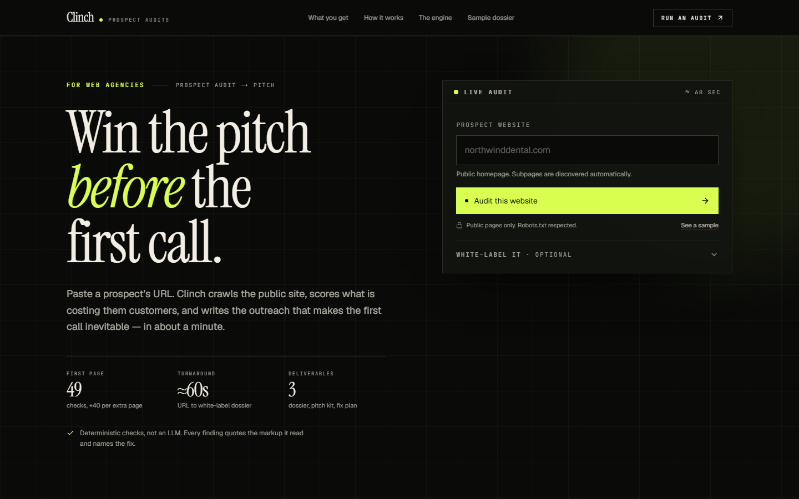
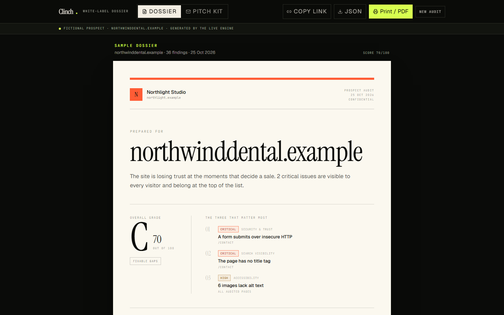
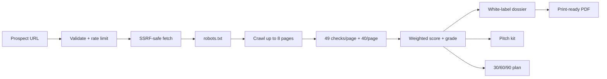

# Clinch

**Win the pitch before the first call.**

Clinch turns a prospect's public website into a white-label audit dossier, a 30/60/90 fix plan, and outreach written from the evidence — in about a minute.

Built for web agencies that prospect with cold email and need to sound like they already did the work.

[**Open the sample dossier →**](docs/sample-audit.pdf)



## The problem

Agencies do not lose pitches because they cannot find problems. They lose them because proving the problems takes too long:

- **72.4%** of web designers say acquiring high-quality clients is challenging, and **3 in 4** say finding new clients got harder in the past year. ([20i 2026 Web Designer Survey](https://www.20i.com/blog/2026-web-designer-survey/))
- Agencies with 15 clients spend **30–75 hours per month** building client reports by hand. ([1ClickReport](https://www.1clickreport.com/blog/marketing-agency-client-reporting-2026))

A useful prospect audit means crawling the site, checking the markup, weighing what matters, writing the report, and drafting the email. Most of a working day before you know whether the lead is worth a sentence.

Clinch compresses that into one URL and one minute. The output is not another dashboard — it is the artifact you would have made anyway: **a report, an action plan, and the email that gets the call.**

## What it produces



| Deliverable | What is inside |
| --- | --- |
| **The dossier** | Overall grade and verdict, weighted category scores, severity-ranked findings with the evidence and the fix, page-by-page register, and a 30/60/90 plan. Print-ready A4, seven pages, in the agency's colors. |
| **The pitch kit** | Two outreach emails in different registers, a follow-up, a call opener, and three talking points tied to actual findings. Every line references a real check. |
| **The fix plan** | Every issue sorted into Now / Next / Later with effort and impact labels — a proposal outline before the first call. |

White-label inputs: agency name, sender, reply-to, accent color (validated hex), raster logo, and booking link. The prospect never sees the Clinch brand on the report.

## How it works

1. **Paste a URL.** One public homepage is enough; subpages are discovered from the navigation.
2. **The engine crawls.** Same origin only, `robots.txt` read before the first request, up to 8 pages, 30 link checks, 24 asset measurements, 2 MB per response, 10 s per page, 40 s overall budget.
3. **Fixed rules produce findings.** Forty-nine checks on the first page, plus forty for each additional page, across search visibility, accessibility, performance, security, and conversion. No LLM, no scoring vibes: the same site produces the same audit.
4. **Findings become a dossier.** Severity, prevalence, and category weights determine the grade. Criticals lead the register and the first fix bucket.
5. **Outreach is composed from the findings.** Subjects, bodies, follow-up, opener, and talking points use the host, the score, and the top three issues — never placeholders.
6. **You send it.** Copy the email, download the JSON, print to PDF, or hand over the link.



The crawl streams NDJSON progress events to the form, so the UI shows pages, checks, and findings as they happen instead of a spinner.

## Scoring

| Category | Weight | Checks per page |
| --- | ---: | ---: |
| Search visibility | 25% | 12 |
| Accessibility | 20% | 10 |
| Performance | 20% | 9 |
| Security & trust | 15% | 9 |
| Conversion readiness | 20% | 9 |

Grades: **A** ≥ 90 (Pitch-ready), **B** ≥ 80 (Solid foundation), **C** ≥ 70 (Fixable gaps), **D** ≥ 55 (Costly gaps), **F** < 55 (Urgent).

Severity controls ordering; prevalence (how many audited pages a finding touches) and category weight control the score.

## Safety and limits

The engine is built to audit public marketing sites, not to probe infrastructure.

- Public `http`/`https` pages only. Credentials in the URL, non-standard ports, localhost, and private/reserved IPv4 and IPv6 ranges are rejected.
- Every redirect hop is re-resolved and re-checked, so a public URL cannot bounce the crawler into a private network.
- `robots.txt` is fetched and obeyed before crawling. Disallowed paths are never requested.
- Hard caps: 8 pages, 5 redirects, 2 MB per response, 10 s per page, 40 s overall, 30 link checks, 24 asset HEAD requests.
- Five audits per IP every ten minutes. The API is `POST /api/audit` and returns NDJSON.
- No accounts, no cookies, no analytics, no LLM, no third-party API keys in the audit path.
- Brand inputs are sanitized: hex-only accents, raster logos under 120 KB, capped lengths. All report content is rendered through React, so crawled markup is never injected as HTML.

Limits are intentional. A demo that can scan the internet is not a demo; it is a liability.

## Quickstart

Requires **Node.js 20.9+**.

```bash
npm install
npm run dev
```

Open [http://localhost:3000](http://localhost:3000), paste a public site, and run an audit. Or open the sample at [http://localhost:3000/audit/sample](http://localhost:3000/audit/sample).

| Script | Purpose |
| --- | --- |
| `npm run dev` | Development server |
| `npm run build` | Production build |
| `npm start` | Serve the production build |
| `npm test` | Vitest suite (155 tests) |
| `npm run typecheck` | `tsc --noEmit` |
| `npm run sample` | Regenerate the sample audit through the real engine against a local fixture |

Optional: set `NEXT_PUBLIC_SITE_URL` to the canonical deployment URL for metadata and Open Graph tags. See [`.env.example`](.env.example).

## Architecture

```text
src/
  lib/audit/
    http.ts          size-limited fetch, redirect validation, timing
    url-safety.ts    URL parsing + DNS + reserved-IP checks
    robots.ts        robots.txt parser and path matching
    crawler.ts       same-origin crawl, link and asset checks
    checks/          seo, accessibility, performance, security, conversion, site-wide
    scoring.ts       weighting, grades, top issues, action plan
    pitch.ts         deterministic email, follow-up, opener, talking points
    compose.ts       findings → Audit object
    store.ts         best-effort JSON file store
  app/api/audit/     streaming NDJSON endpoint
  app/audit/[id]/    server-rendered dossier route
  components/        audit form, dossier sheets, pitch kit, toolbar
scripts/             fictional fixture site and sample generation
docs/                design spec, implementation plan, sample PDF, screenshots
```

Design decisions worth calling out:

- **Deterministic over generative.** The product's credibility depends on every sentence being traceable to a check. The engine is pure TypeScript with no model calls, and the sales copy is composed from the same findings.
- **One crawl, three deliverables.** The dossier, pitch, and plan all derive from a single `Audit` object, so the story cannot drift between artifacts.
- **Print is a first-class view.** The dossier is built as A4 sheets with explicit print CSS for column layouts, page breaks, and backgrounds. Chrome's print viewport is narrower than desktop, so the print rules do not rely on responsive breakpoints.
- **Persistence is deliberately boring.** Locally, audits are written as JSON under `data/audits/` (ignored by Git). The browser also keeps a copy in `localStorage`, so a hosted deploy without durable storage still works for the person who ran the audit.

## Tests

```bash
npm test
```

The suite covers URL safety (including private ranges and redirect hops), robots parsing, capped fetches, extraction, every check category, scoring, pitch copy invariants, rate limiting, the file store, and full audit runs against a local fixture HTTP server. CI runs typecheck, tests, and a production build on every push.

Notable copy invariants enforced by tests:

- Never emit `undefined`, `null`, placeholders, or `[object Object]` in the pitch kit.
- The direct email contains exactly one ask.
- The follow-up names the top finding in a complete sentence.
- A clean site still gets coherent outreach rather than empty claims.

## Deployment

The app is a standard Next.js App Router project and deploys to Vercel without configuration.

```bash
vercel --prod
```

Set `NEXT_PUBLIC_SITE_URL` to the production domain for correct canonical and social metadata.

**Storage on serverless:** Vercel's filesystem is ephemeral, so a hosted audit is not a durable cross-device share. The sample dossier is always available, and audits remain accessible in the browser that ran them via the local fallback. For durable links, add object storage (S3, R2, Vercel Blob) behind `store.ts` and point the dossier route at it.

## License

MIT — see [LICENSE](LICENSE).

Built by [Momčilo Savić](https://github.com/momcilosavic1234567-creator). Fonts: Instrument Serif, Geist, and JetBrains Mono. Icons: Lucide. Crawler: Cheerio. Validation: Zod. Tests: Vitest.
